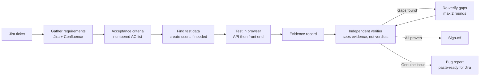

# AI in QA: What I've Built and Learned (2022 → 2026)

I've been in QA for over 18 years, including time as Head of QA. For the last 3–4 years AI has gone from "handy for writing test cases" to doing a big chunk of the testing work itself. Here's what I've built along the way and what I've learned.

**In short:**
- I built an AI manual tester as a Claude plugin. It takes a Jira ticket, works out the requirements, finds test data, tests in the browser, gets an independent agent to check the results, and writes the bug report.
- Before that I worked on a suite of custom GPTs for test case creation, regression planning and reporting, and Playwright automation.
- Outside work I use the same approach to run all the digital side of my wife's tattoo and piercing studio.

---

## Timeline

| When | What | Why it mattered |
|---|---|---|
| Early days | Self-healing Selenium tests, machine learning in test tools | Tests that fixed their own locators. Huge for maintenance at the time |
| Early days | GitHub Copilot | Predictive code made writing automation much quicker |
| Early days | Mabl | Great ideas around ML-driven test creation, but a premium product to invest in |
| 2023–2025 | Custom GPTs | Each one trained up as an expert in one job, following our processes and industry standards |
| 2025–2026 | Playwright + AI | Automation framework with AI planning, execution and reporting |
| 2026 | Claude plugin: AI manual tester | End-to-end ticket testing with independent checking |
| 2026 | Claude dashboards | Release tracking and documentation monitoring, refreshed daily |

Those early tools gave us a glimpse of where things could go. The jump in 2026 has been massive though, and the hard part now is choosing what to build next.

---

## Case Study 1: Custom GPT Suite

**Problem:** A lot of QA time went on admin: writing test cases, planning regression, writing up results. It's important work but it's slow.

**What we built:** A set of custom GPTs, each focused on one task so it gets really good at it:
- **Test case creator.** Generates test cases and test ideas following our internal processes and ISTQB-style standards
- **Regression test planner.** Works out what needs regression testing for a release
- **Regression analysis reporter.** Turns results into a readable report
- **Data hunter.** Finds suitable test data for a scenario
- **Playwright test executor.** Runs and reports on the automated suite

This grew into a framework hooked into Atlassian. A colleague built most of it and I helped build it.

**Outcome:** Big cuts in admin time, and better test ideas than one person comes up with on a busy day.

**Next step:** We haven't yet got it generating the Playwright tests themselves at work. I've done that as a side project and the potential is clear.

---

## Case Study 2: AI Manual Tester (Claude Plugin)

**Problem:** Manual testing a ticket properly means reading the ticket and the Confluence docs, working out the acceptance criteria, finding the right test data, setting up the right user types, testing across environments and writing it all up. AI can do a lot of that, but it can also confidently pass things it never actually proved.

**What I built:** A Claude plugin with a chain of skills, each one handling one specialist area, all linked together.

**Specialist skills include:**
- Business logic and domain reference for the product
- User types and the credentials needed for each
- Access rules for locked or pay-per-view content, tested as a matrix of user tier × section
- Comparing the same record across two environments to prove whether a difference comes from the environment
- Handling bigger, more complex projects
- Bug reports that paste straight into Jira without losing formatting

**Connectors:** Atlassian (Jira and Confluence), Chrome for driving the browser, and Gmail.

**The design decision I'm proudest of:** the verifier is independent. It only gets the acceptance criteria and the raw evidence. It never sees what the tester agent decided, so it can't just agree with it. For each criterion it rules *supported*, *insufficient* or *omitted*. Anything still unproven after two rounds goes in the report as an open gap with a reason. Nothing gets quietly passed.

**Guardrails:**
- Read-only on Jira, Confluence, the code repo and test environments. The AI writes text and I post it.
- Logins stay in my browser. The AI never types or accepts credentials.
- Confluence is the source of truth.

**Outcome:**
- Saves hours of admin per ticket
- Used on every ticket where it's possible
- The whole QA team now uses it
- It builds up a detailed picture of the product over time, so each run gets better

A few years ago I honestly didn't think an AI driving the browser and testing a ticket end to end was possible.

---

## Case Study 3: Two Claudes, Two Jobs

I use Claude in two ways and keep them separate:

- **Claude chat (Cowork)** plans: it breaks the work down, decides the approach and reviews the results.
- **Claude Code in VS Code** builds: it writes the code, runs it and produces the output.

The output goes back to the chat, which checks it and plans the next step. It's the same idea as separating test design from test execution, and it works really well. Each one stays focused and neither ends up marking its own homework.

---

## Case Study 4: Dermoda (My Wife's Tattoo & Piercing Studio)

I build and manage all the digital infrastructure for [Dermoda](https://dermodatraining.co.uk), a tattoo, piercing and training studio. I started with no deployment experience.

**What I set up:**
- **Context files in markdown** covering the business, the tech stack, the Wix website and the booking app, so every AI session starts from the same knowledge
- **Notion as the brain.** Projects, ideas, daily logs, decisions and the reasons behind them, which keeps the work consistent over time
- **Claude driving the Wix site in Chrome** to make changes, add content, and write scripts in Dev Mode for custom features and behaviour

**Built so far:**
- Booking app (React/Vite on Vercel) with two-way calendar sync
- Enquiry form with a dashboard for the studio owner
- Validation helper on the consent forms. When a returning-client check fails, it searches for near matches and emails the studio an overview
- Notion dashboard with a GitHub-style activity heatmap
- Prices and product pages, marketing subscribe form, SEO work

**Outcome:** A small business with a proper digital setup, kept consistent because the AI always works from the same documented context.

---

## Case Study 5: Dashboards and Documentation

**Release Radar:** A dashboard that tracks every open release in Jira, refreshed every weekday morning with a summary:
- Countdown to the release date, red at 3 days or less and amber at 7 or less
- Which test environment the release has reached, worked out from tickets and comments, with manual override
- Ticket progress in the same buckets as the board

**Confluence doc dashboards:** These turn a tree of Confluence pages into one overview: key takeaways, decisions, open questions, actions and QA impact. Each refresh shows *what's changed since last time*, which is really useful on a project where you need to see how decisions were made and what's moved.

**Documentation:** AI has been great for Confluence how-to guides and for writing up the tools themselves. I've written a reusable AI-Assisted QA Playbook and a field guide for the plugin and the Playwright framework.

---

## What I've Learned

1. **Context is everything.** Markdown files, Notion and reference skills. The better the context, the better the output.
2. **Never trust a single AI's verdict.** Keep the evidence apart from the conclusions and get an independent check. Treat AI output like any other test result.
3. **One job per skill.** A focused skill or GPT beats one that tries to do everything.
4. **Separate planning from doing.** It works for people and it works for AI.
5. **Keep a human in the loop.** The AI is read-only on anything that matters, and I post the results.
6. **Build from real work.** Try a new skill on a live ticket straight away and fix it from that run.

---

## What's Next

- Generating Playwright tests directly from the QA chain (done as a side project, next step is bringing it into work)
- A team of agents, including a requirements agent that checks Confluence docs against Jira tickets before testing starts
- AI-assisted PR reviews
- A generic, domain-agnostic version of my QA plugin that any team can use

> **Update, 20 Nov 2026:** AI-assisted PR reviews and the generic, domain-agnostic QA plugin are now built. Both are measured in [AI in my QA workflow](../ai-in-my-qa-workflow/README.md).
>
> *Moved here from the RobBrowning/Ai-Test-Driven-CaseStudy repo on 20 Nov 2026.*
