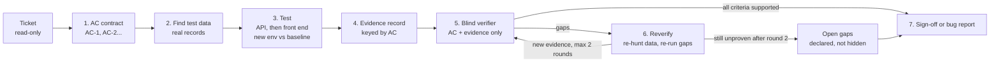
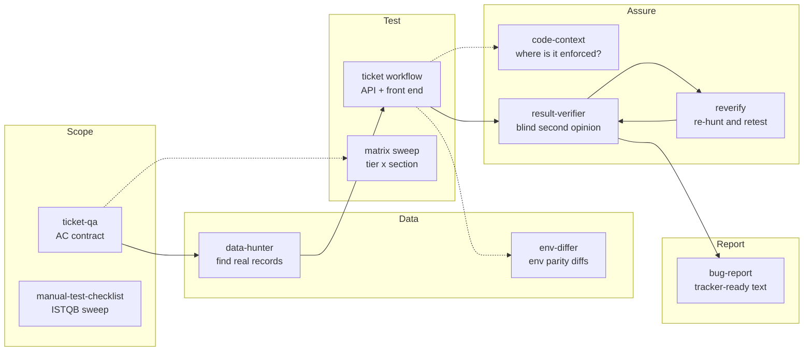
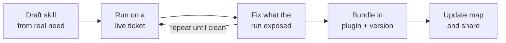

# AI-Assisted QA Playbook

Rob Browning · version 1.1 (public edition) · November 2026

Ways of working built up over three months of testing a subscription website's web releases with Claude (September to November 2026), written so they can be reused on any project or team. Project names, environments and internal tool names have been replaced with generic ones.

## Contents

1. [Why this exists](#1-why-this-exists)
2. [The QA chain: from ticket to sign-off](#2-the-qa-chain-from-ticket-to-sign-off)
3. [The toolkit and how it fits together](#3-the-toolkit-and-how-it-fits-together)
4. [Guardrails: what AI may read and write](#4-guardrails-what-ai-may-read-and-write)
5. [Principles for building QA skills](#5-principles-for-building-qa-skills)
6. [Test accounts and environments](#6-test-accounts-and-environments)
7. [Requirements hidden in images](#7-requirements-hidden-in-images)
8. [Staying on top of releases and docs](#8-staying-on-top-of-releases-and-docs)
9. [Starting a new project: checklist](#9-starting-a-new-project-checklist)

## 1. Why this exists

Over three months of releases (a platform migration, new subscription packs, a freemium tier and several new site sections) a set of habits and tools emerged that made AI-assisted testing trustworthy rather than just fast. The tools were project specific, but the patterns behind them aren't. This playbook captures those patterns so another tester or project can adopt them without repeating the trial and error.

> **The core idea.** AI is good at reading a ticket, finding data and running checks at speed. It is also capable of confidently marking something PASS that was never actually proven. Every pattern here exists to separate what was observed from what was concluded, and to make a second, independent check of that conclusion cheap.

## 2. The QA chain: from ticket to sign-off

Every ticket goes through the same chain. The important design choice is that the verifier receives the acceptance criteria and the raw evidence, but never the tester's pass/fail verdicts. It has to derive its own result, so it can't simply agree with yours.

### What each step guarantees

| Step | What it guarantees |
| --- | --- |
| 1. AC contract | Requirements become numbered criteria before any testing starts. Each one has its text, its source (description, test case, screenshot), the user tier or variant it applies to, the data precondition it needs and the route that can prove it (browser, API, or code-level only). You see the list before testing begins, so missing or misread requirements get caught early. |
| 2. Find test data | Real, existing records that meet each criterion's precondition (an edge case, an unusual record state, a rarely used profile type), rather than whatever page happens to be handy. |
| 3. Test | Data is checked at the API first, then on the front end, on the new-code environment compared against the baseline environment. |
| 4. Evidence record | Observations are recorded against each AC ID (URLs, values, screenshots, signed-in tier), kept apart from the verdicts. |
| 5. Blind verifier | A separate, read-only, browserless agent decides for each criterion: SUPPORTED, INSUFFICIENT or OMITTED. It disagrees with you exactly where your evidence is thin. |
| 6. Reverify | Every finding that isn't SUPPORTED is retested, never settled from memory. The loop is capped at two rounds. |
| Open gaps | Anything still unproven is declared in the write-up with the reason (for example, "needs a local build with mocks"). It is never quietly passed. |
| 7. Sign-off / bug report | Steps / Expected / Actual, referenced by AC ID, produced as formatted text for you to paste into the tracker. |

> **When the browser can't prove it.** Some criteria can't be reached on a shared environment (API-failure fallbacks, server-side branches). The chain doesn't fake these. It names a code-level route instead (a Playwright test, a local build with mock data, a unit test) as a suggestion, and the criterion stays an open gap until someone runs that route.

## 3. The toolkit and how it fits together

The tools are bundled as one plugin. Bundling matters: when a skill refers to another skill, both ship together, so nothing points at a tool only one person has installed.

Reference skills hold project knowledge (subscription packs, account features, access rules), written once and consulted at any step: they read live sources first and use a built-in snapshot only as a fallback.

| Tool | Reusable idea behind it |
| --- | --- |
| ticket workflow | One repeatable workflow per ticket: read, AC contract, data, API, front end, compare, hand off. Change the URLs and environments and it works for any web project. |
| data-hunter | Find existing data that meets a condition instead of inventing it. Ported from the team's command set so it's available across sessions. |
| env-differ | Batch-diff the same record across two environments and report only the differences. It proves a discrepancy is environmental, not a defect. |
| matrix sweep | A matrix test (user tier x site section) driven by the documented source of truth. It always asks for scope; it has no default run. |
| code-context | Read a local checkout, read-only, to find where a rule is enforced, recording the branch and commit it read. |
| result-verifier / reverify | Independent verification, plus a bounded loop to close the gaps it finds. |
| bug-report | Formatted HTML that keeps its formatting when pasted into the tracker. |
| manual-test-checklist | An ISTQB-aligned sweep (browsers, devices, accessibility, security, analytics) with Pass / Fail / N-A tallies. |
| Reference skills | Project knowledge written once, consulted by every workflow skill, and kept fresh from live sources. |

## 4. Guardrails: what AI may read and write

These are hard rules, not preferences. They keep AI tooling safe to point at shared systems.

| Read only | Works here | Writes only here |
| --- | --- | --- |
| Tracker, via the official connector: no comments, no field edits | Claude plus the QA skills: reads, tests, compares, drafts | Paste-ready text: bug reports and results, posted by the tester |
| Docs wiki: the source of truth, never edited | The tester: approves, posts, runs git, logs in | Its own skills and plugin: all fixes go here, not into team repos |
| App repo checkout: no pull, switch or build; the tester drives git | | Published artifacts: dashboards, checklists, maps |
| Team command repo: a reference copy, left for the team | | Files: PDFs, test packs, reports |
| Test environments: tested, never reconfigured | | |

Anything meant for a ticket leaves the AI as text and is posted by a person.

- **Tracker and wiki access goes through the official connector, not browser scraping.** That is the audited route, and it is what company IT policy allowed.
- **Test environments may need to be allow-listed for AI browsing**, and general websites may be blocked. Check this with IT before relying on browser automation on a new project.
- **Logins stay with the tester.** Tier accounts live in the tester's own browser. If the account needed is known, the AI may use it; if it's unclear which tier is needed, it asks.

## 5. Principles for building QA skills

**Build**

- **Live sources first, snapshots as fallback.** Skills read the wiki and tracker when they run. Built-in snapshots exist only for when a source is unreachable, and those get refreshed too.
- **The wiki is the source of truth.** AI search tools are a second opinion, and are useful for resolving naming clashes.
- **Write skills generically so others can use them.** Put shared references inside the plugin so nothing dangles.
- **Ask for scope; don't assume it.** A sweep with a silent default run tests the wrong thing confidently.
- **Suggest code-level routes as text.** The skill names the Playwright, mock or unit-test route; a developer or tester decides whether to build it.

**Improve**

- **Test a new skill on real work immediately**, then fix it with what the run exposed. The first draft is never final.
- **Keep a "before" and "after" reference** (the current matrix vs the proposed one) to catch contradictions and missed edge cases.
- **Record open questions instead of guessing.** Resolve them later against the source.
- **Keep a map of the toolkit** and update it as skills are added, so handoffs and gaps stay visible.
- **Version the plugin** and note what each version changed and why.

## 6. Test accounts and environments

| Rule | Why |
| --- | --- |
| Never upgrade a shared tier account | Team tier logins (one per tier) are shared. Upgrading one breaks everyone else's tests. |
| Create your own user for state-changing tests | Use a plus-addressed email (`name+free31@...`) per test, so you get unlimited fresh accounts in one inbox. Keep a log of which account is on which pack, and the dates. |
| Account age can matter | One upgrade decline only reproduced on a day-old account (pro-rata maths). Keep "aged" accounts ready for retests. |
| Record the tier on both sides of a comparison | Two tiers can legitimately show different content. A screenshot comparison with no tier recorded on each side counts as unproven. |
| Baseline env is not the parity target | The new-code environment can legitimately differ from the environment running current production code. Treat the baseline as "before", not as the expected result. |
| Wait for the deploy | While a ticket is in code review, read it and understand it. Don't test it until it's deployed. |
| Follow the devs' environment call | Some tickets can only be tested on one environment because of environment constraints (billing tenant config, missing routes). Record that in the write-up. |
| Mock data is local only | Mock tooling works on a local dev build, not on shared environments. Failure-path criteria may need that route. |

## 7. Requirements hidden in images

Expected results are often shown only in screenshots inside ticket table cells. On one ticket, 31 of 41 expected results existed only as images. Text-only reading silently drops them.

- Walk the ticket for media nodes, fetch each attachment and view it. Navigating to an attachment URL downloads the file rather than showing it, so render it into a page instead.
- Transcribe each image into a text criterion with its own AC ID. Diff the media IDs across scenario tables so a reused image isn't mistaken for a new requirement.
- Treat a transcribed screenshot as a first-class criterion, and note which tier the reference was captured at.

## 8. Staying on top of releases and docs

**Doc dashboards.** A long wiki tree, PDF or upload becomes one consistent dashboard: key takeaways, decisions, open questions, actions with owners and dates, plus QA impact.

- Several pages merge into one dashboard, with each point attributed to its source page.
- Wiki-sourced dashboards refresh in place at one URL with a "changes since last refresh" section. One-off documents get a new dashboard each time.
- Neutral styling, so they can be shared outside the team.

**Release tracker.** Reads tracker releases and the sprint board, then shows which test environment each release is on and its planned day. The full pattern is in the [Release Radar playbook](../release-radar/README.md).

- Flags by proximity: red at 3 days or fewer, amber at 7 or fewer.
- The environment is detected from ticket text; a manual override survives refreshes.
- Refreshes weekdays at about 08:30 so it's current at stand-up. Purpose: manage workload without last-minute surprises.

## 9. Starting a new project: checklist

- [ ] Identify the source of truth (wiki pages, ticket set, release) and the environments: which runs new code and which is the baseline.
- [ ] Confirm IT access: the tracker connector, allow-listed test hosts, and which browser holds the logins.
- [ ] Write a reference skill for the domain from live docs, with snapshots as fallback. Have workflow skills consult it.
- [ ] Point the ticket-QA workflow at the new environments and API hosts; check the AC contract fields still fit.
- [ ] Write down the test account rules: shared vs own accounts, the email pattern, payment test cards, and who can set up special accounts.
- [ ] Start a field guide for environment quirks, data paths and selectors as you find them.
- [ ] Set up a doc dashboard on the project's wiki tree and add the release to the tracker.
- [ ] Run the first ticket end to end, including the blind verifier. Fix the skills from what it exposes.

## See also

- [AI in my QA workflow](../../case-studies/ai-in-my-qa-workflow/README.md): the same verifier pattern measured with seeded defects.
